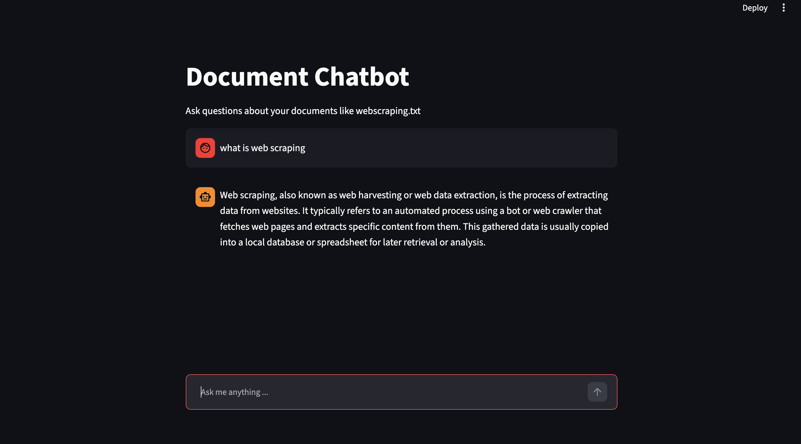

# Document Chatbot (RAG)

A document question-answering chatbot based on FastAPI + Streamlit + LangChain + FAISS + Gemini.

## Features
- Upload PDF / TXT documents and automatically build a vector index
- RAG (Retrieval-Augmented Generation) for accurate answers
- Clean and simple Streamlit chat interface

## Tech Stack
- **Backend:** FastAPI, Uvicorn
- **Frontend:** Streamlit
- **AI Framework:** LangChain, Google Gemini
- **Vector Database:** FAISS, HuggingFace Embeddings